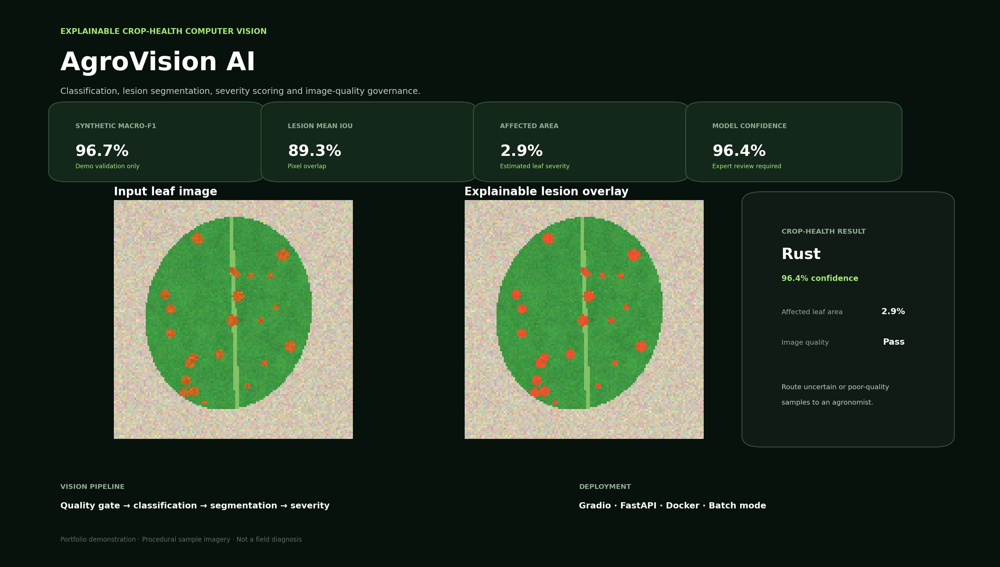

# AgroVision AI

An explainable crop-health computer-vision system for image quality checks, visible-pattern classification, lesion segmentation, severity scoring and expert-review routing.



## Capabilities

- Four visible-pattern classes: Healthy, Leaf Spot, Rust and Blight
- Image-quality gates for blur, brightness and leaf coverage
- Lesion-region segmentation and red visual overlay
- Affected-leaf severity measurement
- Confidence scoring and human-review routing
- Single-image and batch-inspection frontend
- FastAPI, Docker, automated tests and CI
- Optional MobileNetV3 transfer-learning path for real labelled datasets

## Demonstration metrics

| Metric | Result |
|---|---:|
| Synthetic macro-F1 | **96.7%** |
| Lesion segmentation mean IoU | **89.3%** |
| Lesion segmentation mean Dice | See `artifacts/metrics.json` |

**Important:** these metrics use procedural demonstration images. They prove that the packaged pipeline works; they do not represent field accuracy or medical/agronomic diagnosis.

## End-to-end workflow

1. Capture or upload a leaf image.
2. Reject or flag blurred, dark, overexposed or poorly framed inputs.
3. Segment the leaf from its background.
4. Extract colour, texture, gradient and spatial lesion features.
5. Classify the visible pattern with a balanced Random Forest.
6. Segment affected pixels and calculate severity.
7. Overlay affected regions for visual explainability.
8. Route uncertain samples to an agronomist.
9. Serve results through Gradio or FastAPI.

## Run

```bash
python -m venv .venv
source .venv/bin/activate          # Windows: .venv\Scripts\activate
pip install -r requirements.txt
python train.py
python app.py
```

Open `http://127.0.0.1:7860`.

The ZIP includes sample images so the frontend works immediately.

## Real-dataset transfer learning

Place a labelled ImageFolder dataset under `real_data/train/<class>` and `real_data/val/<class>`, then:

```bash
pip install -r requirements-deep-learning.txt
python training/train_transfer_learning.py --data real_data --epochs 8
```

The optional path fine-tunes MobileNetV3 Small. For production segmentation, benchmark SAM2 with agronomist-reviewed masks.

## Resume bullets

- Built an explainable crop-health computer-vision pipeline for image quality validation, four-class leaf-pattern recognition, lesion segmentation and severity estimation.
- Developed colour, texture, gradient and spatial features with a balanced ensemble classifier; achieved **96.7% macro-F1 on procedural validation data** and **89.3% lesion mean IoU**.
- Implemented visual lesion overlays, confidence-based expert routing, batch inspection, Gradio, FastAPI, Docker and automated tests; documented a MobileNetV3 transfer-learning path for real field data.

Read `START_HERE.md`, `docs/INTERVIEW_GUIDE.md` and `docs/MODEL_CARD.md` before presenting the project.
