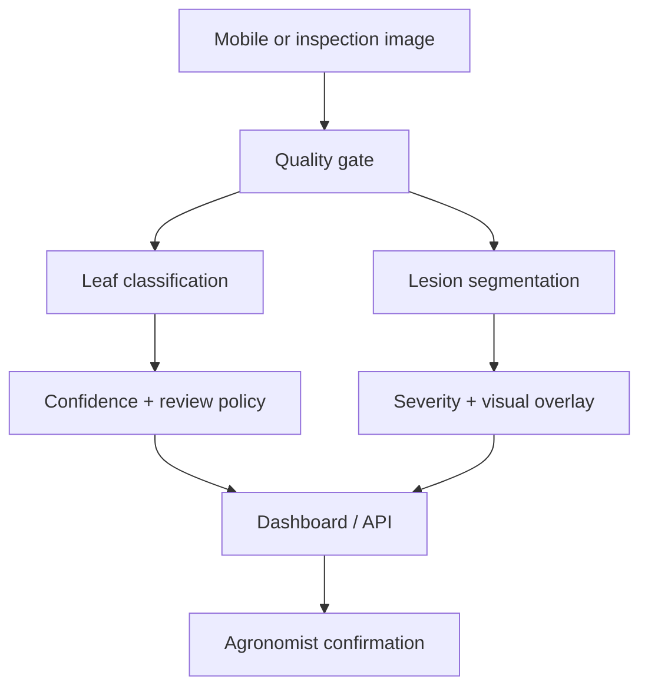

# Architecture

## Runtime requirements

Python, NumPy, SciPy, Pillow, Pandas, scikit-learn, Joblib, Gradio, Plotly, FastAPI, Uvicorn and Matplotlib.

## Production upgrade path

- Representative field images with expert labels
- Geographic and seasonal holdouts
- MobileNetV3 or MobileViT classification
- SAM2 segmentation fine-tuning with reviewed masks
- Confidence calibration and out-of-distribution detection
- Edge quantisation for mobile inference
- Farm-level drift, latency and review-outcome monitoring
