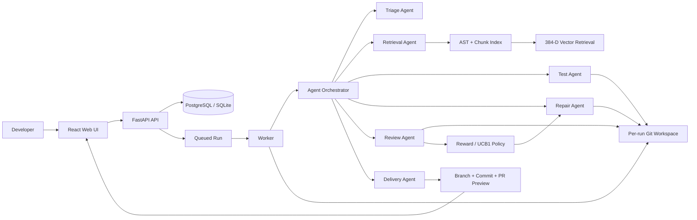
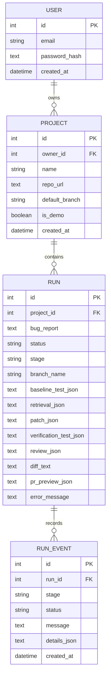

# CodePilot Architecture

## 1. Logical architecture



## 2. Component responsibilities

### React web client
- sign in,
- register/select a repository,
- load the controlled demo,
- submit bug reports,
- poll run state,
- display agent timeline,
- display retrieved code, tests, review score, diff and PR preview.

### FastAPI service
- authentication,
- user/project/run authorization,
- project registration,
- run queue creation,
- run evidence queries,
- health/readiness endpoints,
- generated OpenAPI documentation.

### Worker
Production Docker mode uses a dedicated worker. It claims queued runs and executes the long-running repository workflow outside HTTP request handling. Local development can use inline execution for easier classroom setup.

### Repository service
- validates HTTP(S) repository URLs,
- blocks localhost-style remote URLs,
- creates a fresh workspace per run,
- enforces repository-size limits,
- creates a baseline Git commit for controlled local demo repositories.

### Triage agent
Extracts defect intent, numeric thresholds, inclusive-boundary language, and scope constraints from the natural-language report.

### Retrieval agent
Indexes supported source files. Python functions/classes are parsed with AST; other supported files are chunked by source windows. Each chunk receives a deterministic 384-dimensional hashed vector. Retrieval combines cosine similarity, lexical overlap, path relevance, and a source-code preference over test-only context.

### Test agent
Detects supported repository test commands and captures command, exit code, duration and output for both baseline and verification phases.

### Repair agent
Uses a constrained repair interface. Version 1.0 includes an offline deterministic inclusive-boundary strategy and an optional vendor-neutral HTTP inference contract for broader repair logic. All returned edits are path validated before being written.

### Review agent
Rejects failed verification, empty diffs, excessive changed-file scope, and obvious credential leakage. It also flags selected risky execution patterns.

### Reward-learning policy
Each executed repair strategy receives a bounded reward based on defect reproduction, verification success and review approval. A UCB1 multi-armed-bandit ranking gives successful strategies higher value while retaining an exploration bonus for under-tested strategies.

### Delivery agent
Creates a fix branch, validated commit, pull-request-ready title/body, changed-file list and test evidence. Version 1.0 deliberately stops before remote push/merge so a human remains the final authority.

## 3. Data model



## 4. Run state sequence

```text
QUEUED
  -> TRIAGE
  -> WORKSPACE
  -> INDEXING
  -> BASELINE TESTS
  -> RETRIEVAL
  -> PATCH
  -> VERIFICATION TESTS
  -> REVIEW
  -> REWARD SIGNAL
  -> BRANCH + COMMIT
  -> PR PREVIEW
  -> HUMAN APPROVAL
```

## 5. Trust boundaries

1. Browser input is untrusted and validated by the API.
2. Repository contents are untrusted code/data.
3. Optional inference responses are untrusted edits and must pass path validation, tests and review.
4. Repository test execution is the highest-risk boundary and must run in stronger isolated infrastructure for public external repositories.
5. Production secrets must never be injected into a repository execution environment.
6. Automated approval is not merge authority; a human remains the final decision maker.
