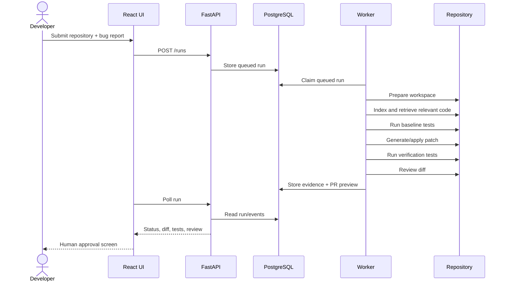

# Diagrams for Report / PPT

## Run sequence

## Recommended PPT figures

1. Problem workflow: Bug -> Search -> Fix -> Test -> Review -> PR.
2. System architecture diagram from `ARCHITECTURE.md`.
3. Database ER diagram from `ARCHITECTURE.md`.
4. Autonomous run sequence above.
5. Security trust boundary: UI/API | Worker Sandbox | External Repository.
6. Demo evidence screenshots.
