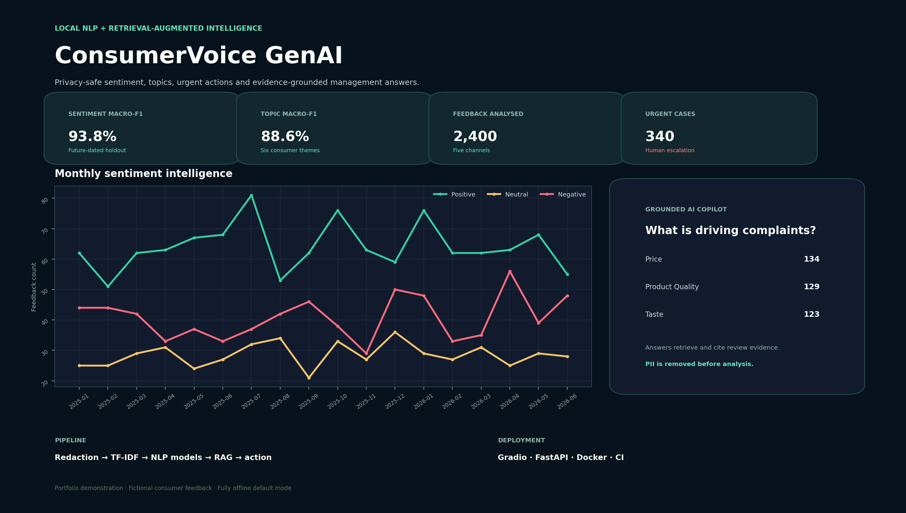

# ConsumerVoice GenAI

An offline-first consumer intelligence system that turns reviews, emails and survey feedback into privacy-safe sentiment, topics, urgent actions and evidence-grounded answers.



## Capabilities

- Three-class sentiment classification with calibrated probabilities
- Six-topic classification: taste, packaging, delivery, price, product quality and service
- Urgent-case detection and human escalation
- Email, phone and order-ID redaction before model processing
- Product-level sentiment trends and complaint dashboards
- TF-IDF retrieval with row-level evidence citations
- Offline grounded answer generation; optional local FLAN-T5 wording
- Gradio frontend, FastAPI, Docker, automated tests and CI

## Validated results

| Model | Future-dated holdout result |
|---|---:|
| Sentiment macro-F1 | **93.8%** |
| Topic macro-F1 | **88.6%** |
| Urgent-case F1 | **88.9%** |

Metrics use 2,400 fictional feedback records with mixed topics and simulated annotation noise. They do not represent a specific company.

## End-to-end workflow

1. Ingest omnichannel consumer feedback.
2. Validate the schema and remove personal identifiers.
3. Transform text into word and character TF-IDF features.
4. Train sentiment, topic and urgent-escalation classifiers.
5. Evaluate on the most recent 25% of records.
6. Index privacy-safe feedback for retrieval.
7. Retrieve evidence for a manager's question.
8. Generate a grounded answer with citations.
9. Expose analysis through the dashboard and REST API.

## Run

```bash
python -m venv .venv
source .venv/bin/activate          # Windows: .venv\Scripts\activate
pip install -r requirements.txt
python train.py
python app.py
```

Open `http://127.0.0.1:7860`.

Optional local instruction model:

```bash
pip install -r requirements-llm.txt
ENABLE_LOCAL_LLM=1 python app.py
```

The first run downloads `google/flan-t5-small`. The default mode is fully offline after project installation and uses extractive grounded generation.

## API

```bash
uvicorn api:app --reload
```

Endpoints: `GET /health`, `POST /analyse`, `POST /ask`.

## Resume bullets

- Built an offline-first NLP and RAG platform that analysed 2,400 fictional omnichannel feedback records with privacy redaction, evidence retrieval and human escalation.
- Achieved **93.8% sentiment macro-F1**, **88.6% topic macro-F1** and **88.9% urgent-case F1** on a future-dated holdout using word/character TF-IDF and regularised classifiers.
- Developed a citation-grounded management copilot, interactive Gradio dashboard and FastAPI service; packaged with Docker, automated tests and CI.

Read `START_HERE.md` and `docs/INTERVIEW_GUIDE.md` before presenting the project.
