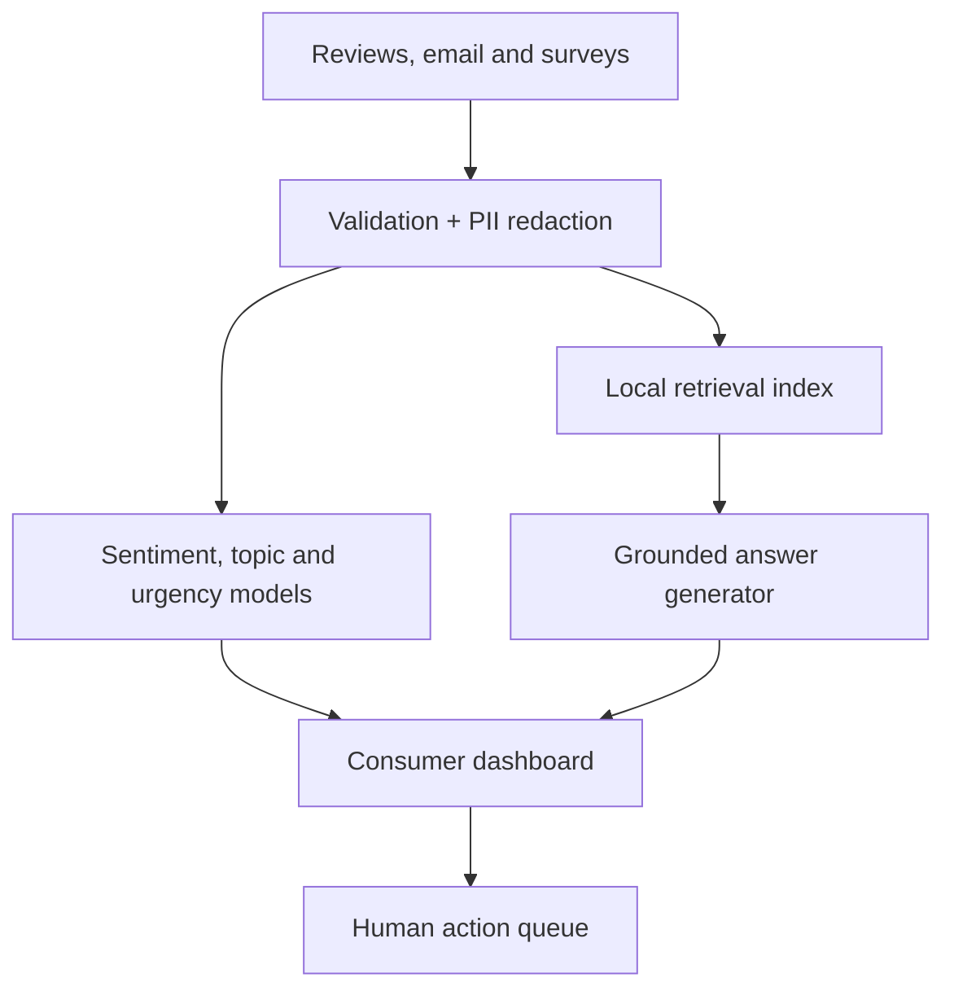

# Architecture

## Runtime requirements

- Python 3.11 or 3.12
- NumPy, Pandas and scikit-learn
- Gradio and Plotly
- FastAPI, Pydantic and Uvicorn
- Joblib and Matplotlib

## Optional local GenAI requirements

- Transformers
- PyTorch
- SentencePiece
- Internet access on the first model download

## Production additions

Multilingual sentence embeddings, FAISS or a managed vector store, streaming ingestion, RBAC, audit logs, model registry, annotation workflow and product-level drift monitoring.
