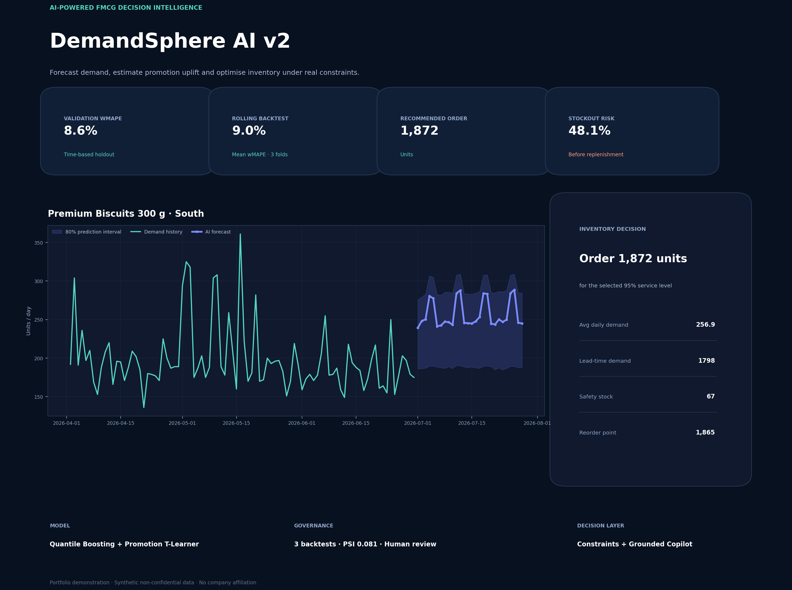
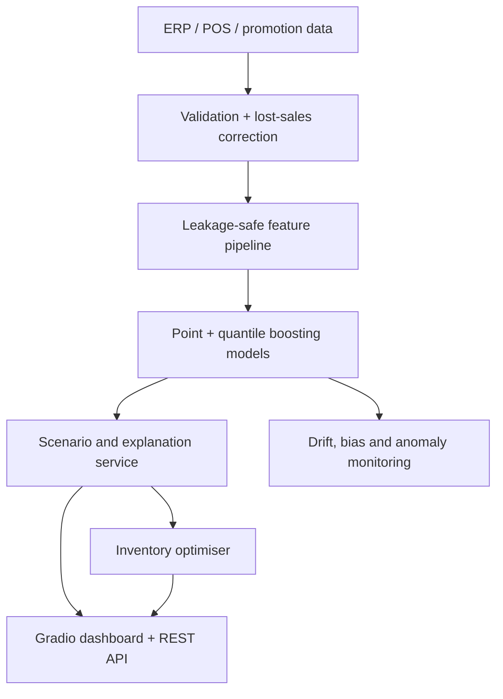

# DemandSphere AI v2

**An end-to-end FMCG demand intelligence and inventory optimisation platform.**

DemandSphere AI forecasts SKU demand by region, produces calibrated prediction intervals, simulates promotion and price scenarios, detects anomalous sales behaviour, monitors drift, and converts demand forecasts into explainable reorder decisions.

> Portfolio disclaimer: all products, transactions and business conditions in this repository are fictional and synthetically generated. The project contains no ITC data and does not claim company affiliation.



## Why this is a strong data science project

This is not only a prediction notebook. It connects the full decision loop:

1. **Data quality:** validates inputs and corrects stockout-censored sales.
2. **Leakage-safe features:** lag, rolling, calendar, promotion, price, competition, marketing and weather signals.
3. **Probabilistic ML:** point plus 10th/90th quantile gradient-boosting models.
4. **Promotion intelligence:** context-adjusted T-learner uplift estimates with an explicit non-causal disclaimer.
5. **Operations research:** case packs, minimum order, warehouse capacity, shelf-life exposure, safety stock and stockout risk.
6. **Explainability:** global permutation importance, scenario reasoning and an offline grounded planning copilot.
7. **MLOps:** repeated rolling-origin backtests, baseline comparison, PSI drift, anomaly detection, versioned artifacts, REST API, tests, CI and Docker.

## Validated results

| Metric | Result | Meaning |
|---|---:|---|
| Validation wMAPE | **8.58%** | Weighted absolute forecast error on unseen future dates |
| MAE improvement | **56.51%** | Improvement over the seasonal lag-7 baseline |
| 80% interval coverage | **77.08%** | Actual demand captured by the uncertainty band |
| Forecast bias | **-1.50%** | Small systematic under-forecast on the holdout |
| Target PSI | **0.081** | Stable distribution; below the 0.10 watch threshold |
| Rolling-backtest wMAPE | **8.98%** | Mean result across three future validation windows |

The final 56 calendar days are never used for model fitting. Metrics are generated by `train.py`, not hard-coded.

## Architecture



## Run the project

Python 3.11 or 3.12 is recommended.

```bash
python -m venv .venv
source .venv/bin/activate          # Windows: .venv\Scripts\activate
pip install -r requirements.txt
python train.py
python app.py
```

Open `http://127.0.0.1:7860`.

Run the REST API:

```bash
uvicorn api:app --reload
```

Then open `http://127.0.0.1:8000/docs` for Swagger.

Run checks:

```bash
python -m unittest discover -s tests -v
python -m compileall src app.py api.py train.py
```

Docker option:

```bash
docker build -t demand-sphere-ai .
docker run -p 7860:7860 demand-sphere-ai
```

## Live demo flow for an interview

1. Select a SKU and region.
2. Set the horizon to 28 days and run the base forecast.
3. Enable a 10% promotion and compare expected uplift.
4. Change current stock and supplier lead time.
5. Show the constrained order, safety stock, binding constraints and stockout risk.
6. Open Promotion Intelligence and ask the Planning Copilot a grounded question.
7. Open Model Governance and explain the three rolling backtests.

## Project structure

```text
demand_sphere_ai/
├── app.py                         # Interactive Gradio dashboard
├── api.py                         # FastAPI production interface
├── train.py                       # Reproducible training pipeline
├── create_demo_preview.py         # Static demo generator
├── src/
│   ├── data.py                    # Synthetic data + quality controls
│   ├── features.py                # Time-series feature engineering
│   ├── modeling.py                # Models, metrics, intervals, drift, anomalies
│   ├── backtesting.py             # Repeated rolling-origin validation
│   ├── promotion.py               # Context-adjusted promotion uplift
│   ├── copilot.py                 # Offline grounded planning answers
│   ├── service.py                 # Recursive forecasting + scenarios
│   └── inventory.py               # Replenishment decisions
├── tests/                         # Functional and data-science tests
├── docs/                          # Architecture, model card, interview guide
├── data/                          # Fictional sample dataset
├── artifacts/                     # Trained models and evaluation outputs
└── reports/                       # Demo preview
```

## Resume bullets

- Built an end-to-end FMCG demand intelligence platform using Python, scikit-learn, quantile gradient boosting, FastAPI and Gradio across 11,520 SKU-region-day records.
- Achieved **8.58% validation wMAPE** and **56.51% lower MAE** than a seasonal baseline using leakage-safe time features and a strict 56-day holdout.
- Converted probabilistic forecasts into case-pack/capacity/shelf-life-aware replenishment decisions; added promotion uplift modelling, an offline planning copilot, anomaly detection, rolling backtests and PSI drift monitoring.

## What to change for real enterprise use

Replace `src/data.py` with an ERP/POS ingestion job; add store-level hierarchy reconciliation; use holiday and weather feeds; deploy the API behind authentication; log forecasts and outcomes to a feature/monitoring store; schedule retraining only after drift and performance gates pass.

See [docs/INTERVIEW_GUIDE.md](docs/INTERVIEW_GUIDE.md) for the explanation script and [docs/MODEL_CARD.md](docs/MODEL_CARD.md) for limitations.
