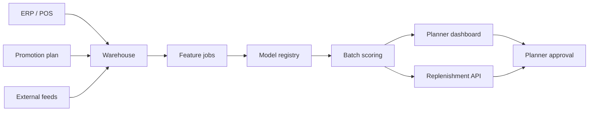

# Architecture and Production Upgrade Path

## Current components

| Layer | Implementation | Responsibility |
|---|---|---|
| Data | Pandas CSV pipeline | Schema checks, stockout correction, reproducible sample data |
| Features | Pandas time transforms | Lag, rolling, calendar and commercial signals without leakage |
| Model | scikit-learn HistGradientBoosting | Point and 10th/90th quantile forecasts |
| Anomalies | Isolation Forest | Flags unusual residual/business-condition combinations |
| Decision | Inventory policy module | Safety stock, reorder point, risk and recommended quantity |
| Promotion | Context-adjusted T-learner | Estimates uplift after controlling for measured demand context |
| Copilot | Grounded offline answer engine | Explains inventory, promotion and model evidence with file citations |
| Explainability | Permutation + counterfactual | Global drivers and promotion scenario comparison |
| Serving | FastAPI + Gradio | Machine API and planner dashboard |
| Quality | unittest + CI | Regression checks and reproducibility |

## Production topology

## Recommended enterprise additions

1. Airflow or managed orchestration for daily feature and scoring jobs.
2. Warehouse tables with point-in-time joins and data contracts.
3. MLflow-compatible experiment tracking and champion/challenger registry.
4. Rolling-origin backtests across categories and regions. Three are implemented in v2; production should expand the history.
5. Hierarchical reconciliation across store, region, SKU and category levels.
6. Conformal interval calibration by demand segment.
7. Optimisation constraints for case packs, minimum order quantity, shelf life, truck capacity and supplier capacity.
8. Forecast value-add reporting to compare AI, statistical baseline and planner overrides.
9. Role-based access, audit log and explicit approval before ERP writeback.
10. Monitoring alerts for data freshness, feature drift, forecast bias, wMAPE and interval coverage.

## API contract

`POST /forecast` accepts SKU, region, horizon, promotion, discount, current stock, lead time and service level. It returns daily point/interval forecasts, an inventory policy and an explanation. `GET /health` supports deployment health checks; `GET /metadata` exposes supported entities and model metrics.
